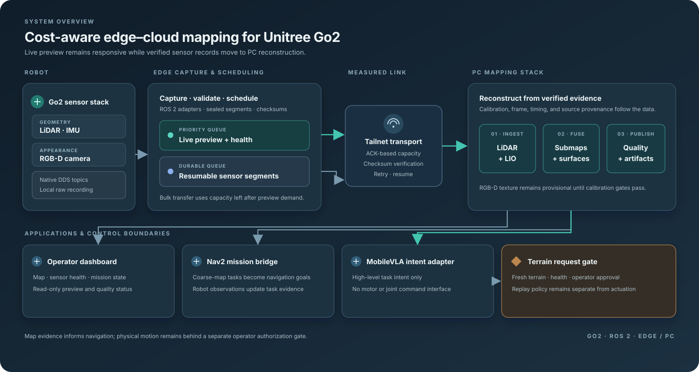

<div align="center">

# Cost-Aware Edge–Cloud Embodied Intelligence

**Indoor mapping, navigation, and safety-gated terrain research on Unitree Go2**

[](https://www.ros.org/)
[](https://www.python.org/)
[](https://mujoco.org/)
[](third_party/)

<br>


*Indoor traversal, stair sequences, and simulation excerpts from the project demonstration.*

</div>

## Project

This project connects a Unitree Go2 robot to a PC mapping stack over a bandwidth-aware link. The robot records LiDAR, IMU, and RGB-D data locally. A low-latency preview is sent first; verified sensor segments use the remaining measured capacity. On the PC, the data feeds mapping, surface reconstruction, the operator dashboard, and Nav2 mission planning.

MobileVLA is used for high-level navigation intent. Terrain policy output remains behind independent evidence and operator gates. The bundled terrain policies support offline replay; they do not authorize robot motion.

## System architecture

<p align="center">
  <a href="docs/architecture.svg"></a>
</p>

The editable source is [`docs/architecture.drawio`](docs/architecture.drawio). Open it with [diagrams.net](https://app.diagrams.net/) or import the SVG into Visio.

## What is included

| Area | Implementation |
| --- | --- |
| Robot sensing | Go2 capture services and native DDS bridges for LiDAR and IMU, plus RGB-D integration |
| Data transport | Preview-priority scheduling, measured-capacity allocation, resumable transfer, and checksum verification |
| Mapping | Calibration contracts, LiDAR/LIO fusion, submaps, reconstruction, and surface-quality checks |
| Operator tools | Dashboard for map, sensor health, mission state, and reconstruction status |
| Navigation | Coarse-map task generation and a mission-to-Nav2 bridge |
| Embodied AI | MobileVLA high-level intent adapter and evidence-gated terrain policy replay |
| Validation | Offline tests, contract checks, and MuJoCo replay tools |

## Repository map

```text
mapping/
  config/       Runtime profiles and redacted examples
  pc/           Mapping, calibration, reconstruction, dashboard, and VLA adapters
  robot/        Go2 capture, DDS bridges, Nav2, and terrain request gates
  tests/        Unit, contract, replay, and acceptance tests
models/         Compact PGTT policies for offline replay
third_party/    Upstream SDKs and minimal simulation assets with their licenses
docs/           Architecture diagram and demo animation
tools/          Setup, deployment, replay, and verification entry points
```

## Run offline checks

The reference PC environment is WSL Ubuntu 24.04 with the `go2-mapping-pc` micromamba environment.

```bash
micromamba activate go2-mapping-pc
python -m pytest -q \
  mapping/tests/test_offline_mapping_nav_pgtt_e2e.py \
  mapping/tests/test_pgtt_adapter.py \
  mapping/tests/test_navigation_package.py
python -m py_compile \
  mapping/pc/go2_mapping_dashboard/server.py \
  mapping/robot/go2_mapping_locomotion/terrain_router.py
```

These checks do not require a physical robot. The repository's full test suite and hardware workflows need the packages and ROS 2 distributions declared in the environment files and deployment scripts.

## Run a MuJoCo replay

Install the simulation dependencies, then run a reference episode and the acceptance matrix:

```bash
python -m pip install mujoco imageio
python tools/run_pgtt_mujoco_reference.py \
  --xml third_party/phase_guided_terrain_traversal/go2/xmls/terrain_test_mjx.xml \
  --steps 1000
python tools/run_pgtt_mujoco_acceptance_matrix.py --episodes 1 --steps 300
```

Reports are written to `output/`, which Git ignores. Simulation reports describe simulation results only.

## Preview the dashboard

```bash
cd mapping/pc/dashboard
npm ci
npm run dev
```

The dashboard code is in `mapping/pc/dashboard/`; the FastAPI service and its map interfaces are in `mapping/pc/go2_mapping_dashboard/`.

## Runtime and evidence boundaries

- MobileVLA returns high-level navigation intent; it has no joint, gait, torque, or motor command interface.
- Terrain execution requires current terrain evidence, runtime health checks, and explicit operator authorization.
- Calibration, frame, and timing metadata travel with source artifacts. Provisional transforms are not promoted as measured calibration.
- The checked-in evidence covers software checks, offline replay, and simulation. It does not establish universally accepted physical stair traversal, watertight building reconstruction, or final calibrated texture for every environment.
- Hardware workflows require the matching Go2, sensor, SDK, and ROS 2 setup. Read the relevant `tools/` entrypoint and config before running one.

## Files kept out of Git

Raw bags, point clouds, generated meshes, model checkpoints, runtime secrets, machine-specific network identities, and large competition media are excluded. The local `materials/` folder may contain source presentation and video files; publish those separately only when redistribution rights are clear. The README animation is the compact demonstration preview.

There is no blanket license for the repository. Each `third_party/` component retains its upstream terms. Check those files before redistributing the corresponding code or assets.

## Citation

If you reference this project, use the metadata in [`CITATION.cff`](CITATION.cff).

## Contact

Yu Ding · GitHub [@ddy-hash](https://github.com/ddy-hash)
