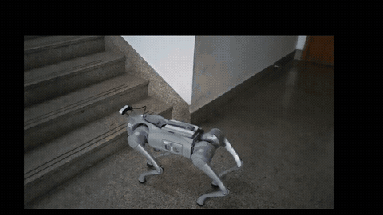

# Cost-Aware Edge-Cloud Embodied Intelligence for Go2

面向城域工业场景的成本感知端云协同具身智能系统。项目以 Unitree Go2 为移动载体，将机器人侧的 LiDAR / IMU / RGB-D 采集、PC 侧的高保真建图与三维重建、语义导航、MobileVLA 高层意图适配，以及带安全门控的地形策略回放组织成一个可审计的 ROS 2 工程。

> This repository is a research and reproducibility package. It contains source code, simulation assets, compact replay policies, validation tests, and deployment scripts. Hardware motion remains operator-authorized and fail-closed.



The clip shows the Go2 indoor navigation and stair traversal demo. The full
source video is kept out of Git because GitHub rejects files of this size.

## Implementation

The PC and robot communicate over a measured link. The robot sends preview data first, then uploads closed sensor segments as bandwidth allows. Uploads resume by chunk and are acknowledged only after checksum verification and reconstruction ingest.

On the PC, LiDAR and LIO observations feed mapping and surface reconstruction. Calibration, frame IDs, timing residuals, and source hashes travel with the artifacts so later stages can check where each result came from. The Dashboard displays those results and their quality state.

MobileVLA is limited to high-level navigation intent. Terrain execution has a separate request gate with sensor, policy, and operator checks; the bundled PGTT policies are used for offline replay and do not authorize robot motion.

## System layout

```text
Go2 sensors and DDS
        |
        v
Robot adapters and capture services  --->  local durable spool
        |                                      |
        +---- preview / health ---------------+---- measured uplink
                                                       |
                                                       v
PC mapping core --> fusion --> reconstruction / appearance --> dashboard
        |
        +--> Nav2 mission bridge
        +--> MobileVLA intent adapter
        +--> terrain evidence and safety gate --> read-only/sim replay
```

## Repository map

| Path | Purpose |
| --- | --- |
| `mapping/pc/` | Mapping, calibration, fusion, reconstruction, Dashboard, quality gates, and VLA adapters |
| `mapping/robot/` | Go2 capture, native DDS bridges, Nav2 integration, telemetry, and locomotion request gates |
| `mapping/tests/` | Unit, contract, offline replay, and acceptance-matrix tests |
| `mapping/config/` | Versioned schemas and example configuration; machine-specific identities stay local |
| `tools/` | WSL setup, build, validation, replay, deployment, and maintenance entry points |
| `models/pgtt-go2/` | Compact PGTT Go2 policies used by offline replay tests |
| `third_party/` | Vendored upstream interfaces and minimal simulation assets; see their local license files |
| `materials/` | Local competition reports, slides, and demonstration media; large files are intentionally not committed |

## Quick start: offline checks

The reference development environment is WSL Ubuntu 24.04 with the `go2-mapping-pc` micromamba environment. From the repository root:

```bash
micromamba activate go2-mapping-pc
python -m pytest -q \
  mapping/tests/test_offline_mapping_nav_pgtt_e2e.py \
  mapping/tests/test_pgtt_adapter.py \
  mapping/tests/test_navigation_package.py
python -m py_compile \
  mapping/pc/go2_mapping_dashboard/server.py \
  mapping/robot/go2_mapping_locomotion/terrain_router.py
```

The tests above do not require a physical robot. Hardware and ROS 2 launch scripts require the matching Unitree, Livox, RealSense, Nav2, and ROS 2 installations described by the scripts in `tools/`.

## Simulation replay

The MuJoCo replay path is the smallest reproducible demonstration:

```bash
python -m pip install mujoco imageio
python tools/run_pgtt_mujoco_reference.py \
  --xml third_party/phase_guided_terrain_traversal/go2/xmls/terrain_test_mjx.xml \
  --steps 1000
python tools/run_pgtt_mujoco_acceptance_matrix.py --episodes 1 --steps 300
```

Reports are written under `output/`, which is ignored by Git. They are simulation evidence only and do not authorize hardware locomotion.

## Dashboard preview

The lightweight Three.js dashboard is in `mapping/pc/dashboard/`:

```bash
cd mapping/pc/dashboard
npm ci
npm run dev
```

The dashboard is an operator-facing visualization for map, trajectory, sensor health, and quality state. It does not replace the runtime safety gates.

## Public-release boundary

Raw bags, point clouds, generated meshes, model checkpoints, runtime tokens, Wi-Fi profiles, tailnet identities, and large competition media stay out of Git. The local `materials/` directory may contain the original working files; use a release or an institutional artifact store for media you have permission to publish.

Some runtime configurations contain device serial numbers or private network addresses and are ignored by `.gitignore`. Copy the corresponding `*.example.*` file and provide local values before running hardware workflows. Never commit tokens or private keys.

The project does not apply a blanket license to vendored code or competition materials. Original project files may be reused for research and portfolio review with attribution; each directory under `third_party/` remains subject to its upstream license, which must be read before redistribution.

## Evidence and limitations

The included evidence supports offline replay, simulation, LiDAR/IMU observation, and software-level acceptance checks. It does not claim a universally accepted physical stair traversal, a watertight building model, or calibrated final RGB texture for every environment. See [`SUBMISSION_INDEX.md`](SUBMISSION_INDEX.md) for the original reproducibility boundary and evidence notes.

## Contact

Maintainer: Yu Ding (`ddy-hash`).
